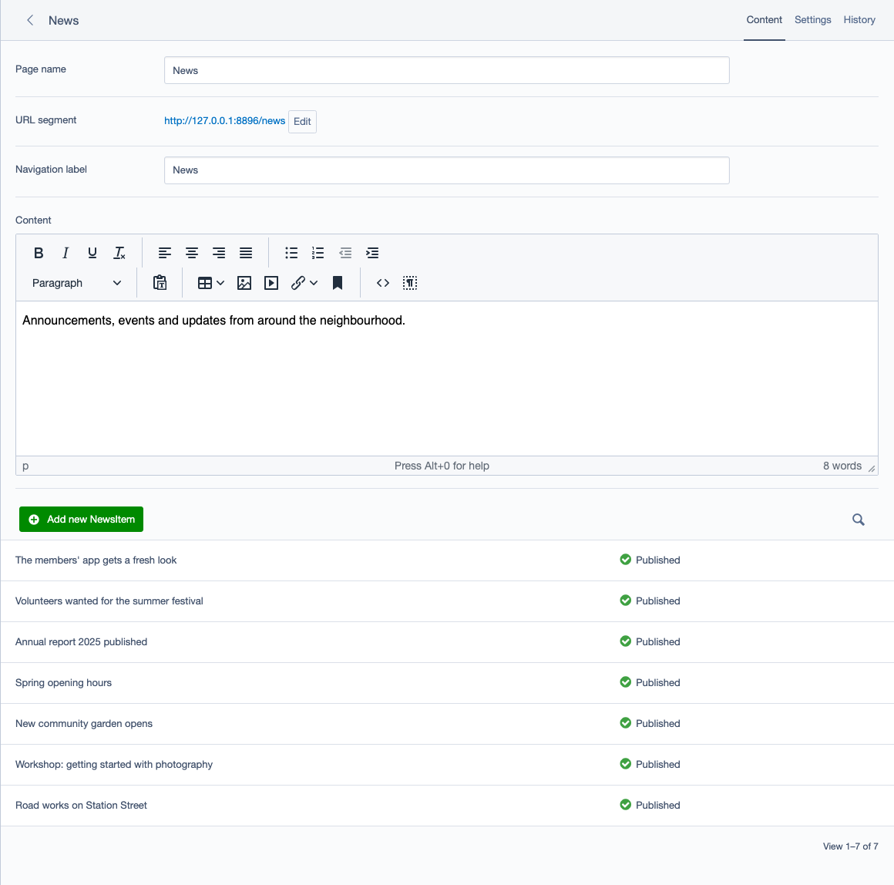
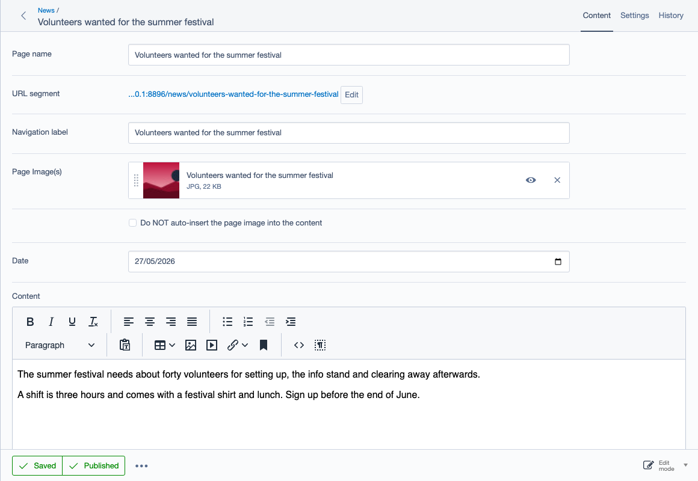

News grid for Silverstripe
==========================

Keep news items out of the CMS site tree. A News section page lists its news items in a grid
directly below its Content, where editors add, open and publish them, and shows them on the site as
a paginated list, newest first. Each news item is a normal page with a date and a featured image.
For Silverstripe 5 and 6.



*Maintained by [Restruct](https://github.com/restruct). If this module saves you time, you can
[support ongoing maintenance](https://github.com/sponsors/restruct).*

## Out of the box, every news item is a node in the site tree

Silverstripe keeps pages in one site tree. News items are pages, so each one becomes a node under
its parent, and after a year or two of news the archive outnumbers every other page on the site:
the section has to be expanded and scrolled past to reach anything else, and finding one item
means scrolling through all of them. Core has no page type that lists its children in a grid
instead.

This module manages news items in a grid on their News section (through
[silverstripe/lumberjack](https://github.com/silverstripe/silverstripe-lumberjack)), and adds the
two page types, their CMS fields and the front-end templates to go with it.

## News sections and news items

It adds two page types:

- **News section** (`Restruct\SilverStripe\NewsGrid\NewsGridHolder`): a page whose news items are
  listed in a grid on its Main tab, directly below Content, instead of in the CMS site tree.
- **News item** (`Restruct\SilverStripe\NewsGrid\NewsGridPage`): a page with a `Date` and one or
  more featured images. Items can only be created inside a News section and are hidden from the
  CMS site tree (on Silverstripe 6, see
  [the site tree on Silverstripe 6](#known-issue-news-items-in-the-site-tree-on-silverstripe-6)).

### The news items grid

The grid lists the section's own news items, newest first (`default_sort: Date DESC`), with their
title and publication state: Published, Modified (published, with unpublished changes) or Draft.
"Add new NewsItem" creates an item inside the section; a row opens the item in the editor. With
`managed_object_date_field` set (filterablearchive sets it, see
[Optional integrations](#optional-integrations)) the grid also shows a Date column, and with
softscheduler a Scheduling column.

### Editing a news item



A news item has a Date field directly before Content, on Silverstripe 5 and 6 and with or without
filterablearchive. A new item is dated today. Its featured image comes from
[restruct/silverstripe-featuredimages](https://github.com/restruct/silverstripe-featuredimages)
(one image by default, its `max_featured_images` config). The news item layout shows that image
next to the content; tick "Do NOT auto-insert the page image into the content" to leave it out (in
templates: `$NoAutoImage`).

### On the site


The module ships `Layout` templates for both page types (in
`templates/Restruct/SilverStripe/NewsGrid/Layout/`), marked up with Bootstrap 5 classes; your
theme's `Page.ss` provides the page around them. Override them in your theme like any other
template.

- **The News section page** lists its published news items, newest first, each with its featured
  image, title and first paragraph, `items_per_page` (12) to a page with page links below
  (`templates/Includes/NewsGridPagination.ss`).
- **A news item page** shows its title, featured image and content, and a link back to its News
  section.

The screenshot above shows the templates with Bootstrap's stylesheet and four items to a page.

### Optional integrations

Each of these is picked up automatically when the package is installed, and ignored otherwise.

- **[restruct/silverstripe-filterablearchive](https://github.com/restruct/silverstripe-filterablearchive)**:
  date archive, categories and tags. Applies its holder, holder controller and item extensions,
  sets `managed_object_date_field: Date` and `pagination_control_tab: Root.Filtering`, and the
  templates show the filter, the item properties and pagination.
- **[restruct/silverstripe-softscheduler](https://github.com/restruct/silverstripe-softscheduler)**:
  scheduled publication and expiry. Applies `EmbargoExpiryExtension` to news items, adds a
  "Scheduling" column to the grid, and moves the scheduling fields below Content.
- **[restruct/silverstripe-blockbase](https://github.com/restruct/blockbase)**: declares the
  `BlockNewsItems` block, which shows the most recent news items (optionally limited to one
  filterablearchive category) with an optional link to the first News section. Without blockbase
  the class is not declared at all. Needs blockbase `^2` (Silverstripe 5 and 6, elemental `^5.4 || ^6`);
  blockbase 1.x requires Silverstripe 4.

### Known issue: news items in the site tree on Silverstripe 6

On Silverstripe 6, news items are left out of the site tree only while it is loaded from the Pages
screen (`admin/pages`). Once a page is open in the editor (`admin/pages/edit/...`, including a
reload of that screen), the tree is loaded again and lists the news items under their section.
On Silverstripe 5 they stay out of the tree on both screens. The filtering is done by
`SelectiveLumberjack` from restruct/silverstripe-admintweaks, which this module applies; the fix
is tracked in [admintweaks#105](https://github.com/restruct/silverstripe-admintweaks/issues/105).

## Technical

### Version compatibility

| Branch | Module version | Silverstripe | PHP |
|--------|----------------|--------------|-----|
| `main` | `3.1.x`, `3.2.x` | `^5 \|\| ^6` | `^8.1` |
| (tags only) | `3.0.x` | `^6` | not declared |
| `v2` | `2.0.x` | `^4 \|\| ^5` | not declared |

Silverstripe 4 reached end of life in April 2025 and is no longer supported or tested here. Projects
still on it can stay on the `2.0.x` tags, which remain available. The Silverstripe 3 predecessor
was published as `micschk/silverstripe-newsgrid`.

`main` is the maintained line: it supports every Silverstripe version this module still targets.

**`composer.json` is the source of truth** for exact constraints; this table is a quick reference.

Upgrading from 2.x or 3.0.x? See [CHANGELOG.md](CHANGELOG.md).

### Requirements

* Silverstripe 5 or 6
* PHP 8.1 or newer
* [silverstripe/lumberjack](https://github.com/silverstripe/silverstripe-lumberjack),
  [restruct/silverstripe-admintweaks](https://github.com/restruct/silverstripe-admintweaks) and
  [restruct/silverstripe-featuredimages](https://github.com/restruct/silverstripe-featuredimages)
  (installed automatically)
* Your project's own `Page` and `PageController` classes: both page types extend them.

### Installation

```
composer require restruct/silverstripe-newsgrid
```

Then run `dev/build` (Silverstripe 5) or `sake db:build` (Silverstripe 6), and flush.

A database carrying the Silverstripe 3 class names (`NewsGridHolder`, `NewsGridPage`, from
`micschk/silverstripe-newsgrid`) is remapped to the namespaced classes during that build
(`_config/upgrade.yml`).

### Configuration

Everything below is set by the module's own `_config/config.yml`; override it in your project's
YAML as needed.

```yaml
Restruct\SilverStripe\NewsGrid\NewsGridHolder:
  # Lumberjack variant from admintweaks that manages the child pages in a grid
  extensions:
    - Restruct\Silverstripe\AdminTweaks\Extensions\SelectiveLumberjack
  # Core Hierarchy setting: keep news items out of the CMS site tree
  hide_from_cms_tree:
    - Restruct\SilverStripe\NewsGrid\NewsGridPage
  allowed_children:
    - Restruct\SilverStripe\NewsGrid\NewsGridPage

Restruct\SilverStripe\NewsGrid\NewsGridPage:
  extensions:
    - Restruct\SilverStripe\FeaturedImages\FeaturedImageExtension
```

| Option | On | Default | Effect |
|--------|----|---------|--------|
| `managed_object_date_field` | `NewsGridHolder` | not set (set to `Date` when filterablearchive is installed) | When set, the news items grid shows that field as a "Date" column. Without it the grid shows the title only. |
| `hide_from_cms_tree` | `NewsGridHolder` | `[NewsGridPage]` | Page classes left out of the CMS site tree under a News section. |
| `default_sort` | `NewsGridPage` | `Date DESC` | News items are listed newest first. |
| `apply_sortable` | `NewsGridHolder` | `false` | **No effect with this module alone.** Only `micschk/silverstripe-gridfieldpages` reads it (its `GridFieldPageHolderExtension`, Silverstripe 4 only), which `_config/config.yml` leaves commented out. With that extension applied, `true` adds drag-and-drop ordering to its pages grid. |
| `items_per_page` | `NewsGridHolder` | `12` | News items per page on the News section page **without** filterablearchive (where it is installed, its per-section "items per page" setting applies instead). `0` lists every item on one page. The page links render from `templates/Includes/NewsGridPagination.ss` (same markup as filterablearchive's Bootstrap pagination). |

The CMS stylesheet `client/css/newsgridpages.css` is added to every admin screen through
`LeftAndMain.extra_requirements_css`.

### Public API

| Method | On | Returns |
|--------|----|---------|
| `getLumberjackPagesForGridfield()` | `NewsGridHolder` | The News section's own news items as `NewsGridPage` records, so the grid can sort on `Date`. |
| `getLumberjackTitle()` | `NewsGridHolder` | The grid's title (translatable, `NEWSGRID.NewsItems`). |
| `formattedPublishDate()` | `NewsGridPage` | The item's `Date` through `Format('d MMM y')` (a CLDR pattern, not a PHP `date()` one): day, abbreviated month name and calendar year, e.g. `2 Jan 2026`. The month name follows the site locale (`nl_NL`: `2 jan 2026`). Before 3.1.0 it used `d M Y`, which rendered `2 1 2026` (month number, week-year). |
| `PaginatedItems()` | `NewsGridHolderController` | The News section's news items for its page, newest first, in the current reading mode. Provided by filterablearchive (filtered and paginated) when installed; otherwise by this module's `Extensions\PaginatedItemsFallback`, applied only then, paginated by `items_per_page` over the request's `?start=`. A `PaginatedItems()` on the section record itself takes precedence over the fallback. A project template overriding `Layout/NewsGridHolder.ss` needs `<% include NewsGridPagination %>` for the page links. |
| `DateFieldComment()` | `NewsGridPage` | `(x minutes ago)` for items dated within the last hour; requires filterablearchive. |
| `RecentNewsItems($limit = 3)` | `BlockNewsItems` | The most recent news items, optionally filtered by category. |
| `NewsSectionLink()` | `BlockNewsItems` | The first News section, labelled for the "all news" link, or `null` when no label is set or no News section exists. |

In templates, `$NoAutoImage` on a news item tells the layout not to insert the featured image into
the content automatically.

### Running the tests

The suite needs a booted Silverstripe project that provides `Page` and `PageController`. Install the
module as a symlinked path repository (a dist install contains no tests), then:

```
# Silverstripe 5 (PHPUnit 9): the path must come before flush=1
vendor/bin/phpunit vendor/restruct/silverstripe-newsgrid/tests flush=1

# Silverstripe 6 (PHPUnit 11)
SS_PHPUNIT_FLUSH=1 vendor/bin/phpunit vendor/restruct/silverstripe-newsgrid/tests
```

`.github/workflows/ci.yml` builds exactly such a host project for each supported major.

Some checks skip themselves on purpose, so the test count depends on what the host has installed:

- `NewsGridTemplatesTest` (3 tests) is skipped when restruct/silverstripe-filterablearchive is
  installed. It checks that the templates render *without* that module (its includes are guarded
  so a missing template does not throw), which a host that has it cannot show. The other side, the
  includes rendering when filterablearchive is present, is covered by `NewsGridTemplateGuardTest`
  with a stand-in, which runs either way.
- `NewsGridPageDateFieldTest::testFilterablearchivesOwnDateFieldIsNotDuplicated` is skipped when
  filterablearchive is not installed; the four `NewsGridLayoutContentTest` tests of the fallback
  list (pagination, a subclass's `items_per_page`, a record's own `PaginatedItems()`) when it is.
- `ModuleConfigTest::testBlockIsNotDeclaredWithoutBlockbase` is skipped when blockbase is installed;
  `ModuleConfigTest::testBlockTypeDescriptionIsReadByElemental` and `BlockNewsItemsCmsFieldsTest`
  when it is not.

`NewsGridLayoutContentTest` and `BlockNewsItemsCmsFieldsTest` expect different things with and
without filterablearchive and both pass either way. To cover every side, run the suite on a host
without the optional modules and on one with blockbase `^2` and filterablearchive `^3.1`; blockbase
without filterablearchive is the combination that once broke `BlockNewsItems`' CMS fields.

Browser tests (Playwright, against a real CMS) live in `tests/browser/` and run in
`.github/workflows/browser-tests.yml`. The screenshots in this README are generated from the same
fixtures; see [tests/browser/screenshots/README.md](tests/browser/screenshots/README.md) to
regenerate them.

### Changelog and license

Release history: [CHANGELOG.md](CHANGELOG.md). License: MIT, see [LICENSE](LICENSE).
